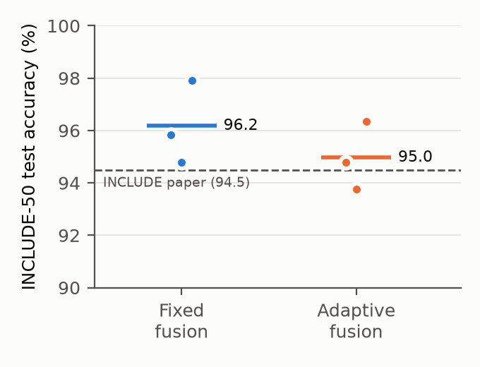
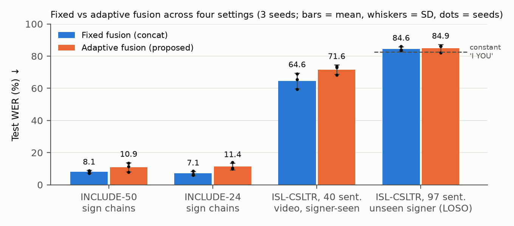

# Landmark-Based Indian Sign Language Recognition: Isolated Signs, Sign Sequences, and Adaptive vs Fixed Fusion

This project has two parts:
- **A research study:** a pre-registered, statistically tested evaluation of adaptive (reliability-aware) multimodal fusion for ISL recognition.
- **A working system:** OpenCV apps that recognise ISL signs from held-out test videos and live from a webcam.

> **What this project is, and isn't.**
> - **The model:** a *continuous* recogniser. It is trained with CTC and reads the video stream without being told where signs start or end.
> - **Strong results:** these are on **isolated signs** (INCLUDE-50: 96.2 %) and on **sequences made by joining isolated clips**. Those sequences lack the natural transitions (co-articulation) of real signing.
> - **Weak results:** on **natural continuous ISL sentences** (ISL-CSLTR) accuracy is low, and on unseen signers it is no better than a constant output. Continuous ISL sentence recognition remains **unsolved** here, and the paper reports it as such.

**Headline results** (all on held-out test data):
- **INCLUDE-50 benchmark:** 96.2 ± 1.6 % test accuracy (fixed fusion, 3 seeds), on par with the 94.5 % published by the dataset authors. Each run trains in 5 min on a laptop CPU.
- **Sign sequences (joined isolated clips):** 8.1 % WER on chains of held-out INCLUDE-50 clips, with no sign boundaries given.
- **Adaptive vs fixed fusion:** adaptive fusion never beat simple fixed fusion in any of 4 settings.
- **ISL-CSLTR, unseen signers:** no model beats a constant "I YOU" output (82.5 % WER). **Negative result.**

---

## Results
Sources: `results/`, `reports/FINAL_REPORT.md`. Figures and tables are regenerated by `python paper/make_figures.py`.

### 1. INCLUDE-50 benchmark (official AI4Bharat split: 689 train / 77 val / 192 test clips, 50 signs)
| Model (3 seeds) | Test accuracy ↑ | Free-decoding accuracy ↑ | Sign-chain WER ↓ | Exact chains ↑ | Train time per run |
|---|---:|---:|---:|---:|---:|
| INCLUDE paper (best reported) | 94.5 % | – | – | – | – |
| **Fixed fusion (concat)** | **96.2 ± 1.6 %** | **92.5 ± 1.6 %** | **8.1 ± 0.8** | **81.2 %** | 5.0 min |
| Adaptive fusion (proposed) | 95.0 ± 1.3 % | 89.6 ± 2.1 % | 10.9 ± 2.8 | 75.0 % | 5.9 min |



- **Test accuracy:** the class with the highest CTC likelihood among the 50 signs, as in the INCLUDE paper.
- **Sign chains:** 400 sequences of 1–4 held-out test clips.
- **Uncertainty:** 3 seeds give a 95 % interval of roughly ±4 points, so treat the result as *on par with* the published baseline, not better. Newer INCLUDE-50 results have not been surveyed.

### 2. INCLUDE, 24-sign subset (used by the live demo)
| Model (3 seeds) | Isolated-sign accuracy | Sign-chain WER ↓ | Exact chains |
|---|---:|---:|---:|
| Fixed fusion | **93.1 ± 2.0 %** | **7.1 ± 1.3** | **82.0 %** |
| Adaptive fusion | 88.2 ± 1.3 % | 11.4 ± 2.1 | 71.7 % |

### 3. Fixed vs adaptive fusion across all settings (test WER %, lower is better)
| Setting | Fixed fusion | Adaptive fusion |
|---|---:|---:|
| INCLUDE-50 sign chains | **8.1 ± 0.8** | 10.9 ± 2.8 |
| INCLUDE-24 sign chains | **7.1 ± 1.3** | 11.4 ± 2.1 |
| ISL-CSLTR videos, 40 sentences, signer-seen | **64.6 ± 4.8** | 71.6 ± 2.9 |
| ISL-CSLTR key-frames, 97 sentences, unseen signer (LOSO) | 84.6 ± 1.4 | 84.9 ± 2.4 |



### 4. Pre-registered study on ISL-CSLTR (97 sentences, 7 signers)
**Unseen signers (leave-one-signer-out, 3 seeds):**

| Model | WER ↓ | Sentence acc. ↑ | Gloss F1 ↑ |
|---|---:|---:|---:|
| *Constant output "I YOU" (no learning)* | **82.5** | 0.0 | 26.4 |
| RGB only | 84.0 ± 1.1 | 3.0 | 27.3 |
| Cross-modal attention fusion | 83.7 ± 1.2 | 0.7 | 24.1 |
| Fixed fusion (RGB + pose + hand) | 84.6 ± 1.4 | 2.3 | 23.1 |
| Adaptive fusion (proposed) | 84.9 ± 2.4 | 2.3 | 21.7 |
| Hand-crop RGB + pose + hand, fixed / adaptive | 86.6 / 86.4 | – | – |

**Signers seen in training (random split):**

| Model | WER ↓ |
|---|---:|
| Closed-set sentence classifier | **61.0 ± 3.6** |
| Hand landmarks only | 72.6 ± 2.1 |
| Adaptive fusion | 75.8 ± 2.1 |
| Fixed fusion | 78.7 ± 3.3 |
| RGB only | 83.7 ± 3.1 |

### 5. Statistical tests (pre-registered)
| Comparison | Δ WER (proposed − comparator) | 95 % CI | p |
|---|---:|---:|---:|
| **Primary:** adaptive vs best baseline (RGB-only, chosen on validation), unseen signers | +0.9 | [−1.2, +2.9] | 0.30 (permutation); signer-level 0.55 |
| Adaptive vs fixed, 5 degraded conditions (missing modality, speed) | −0.9 to +0.8 | all include 0 | all p_Holm ≥ 0.56 |
| Adaptive vs RGB-only, signers seen | −7.9 | [−12.9, −2.8] | 0.006 (Holm) |
| Adaptive vs fixed, signers seen | −2.9 | [−6.3, +0.5] | 0.12 |

### 6. What the adaptive fusion learned
- **Missing modalities:** removing a modality lowers its weight (RGB 0.36 → 0.21, hand 0.32 → 0.24), but only partly.
- **Tracking quality:** the hand weight rises with the hand-detection rate (ρ = 0.38).
- **No link to errors:** gate confidence is unrelated to recognition errors (ρ = 0.04).
- **Collapse:** in 3 of 7 folds the gate collapsed onto a single modality, and which modality varied from fold to fold.

### 7. Error analysis (ISL-CSLTR, unseen signers)
- **Rare glosses:** glosses seen in only one sentence (115 of 162) are recalled 8–13 % of the time, against 27–30 % for frequent ones.
- **Common errors:** pronoun confusions dominate (YOU→I, ME→YOU), and deletions outnumber substitutions.
- **Position in the sentence:** error rate is 73 % on the first gloss, 86 % in the middle, and 94 % on the last.
- **Recording setup:** phone recordings of native signers score 87.6 % WER, against 83.7 % for DSLR recordings.

### 8. Efficiency (Apple M2, CPU only)
| | Value |
|---|---|
| Model size | 1.3 M parameters (landmarks); 43–67 MFLOPs per sentence |
| Training | 5–6 min per INCLUDE-50 run; 31–41 s per ISL-CSLTR-video run |
| Inference | 2–10 ms per sentence; live webcam ≈ 13 fps, limited by MediaPipe tracking |
| Full INCLUDE-50 pipeline (download, tracking, 6 trainings) | 1 h 52 min |

**Publication readiness of the original adaptive-fusion claim: 15 / 45.** It is not supported. See [reports/FINAL_REPORT.md](reports/FINAL_REPORT.md) §18.

---

## Research paper topic (one joint paper)

### Recommended main topic
> **"Lightweight Landmark-Based Indian Sign Language Recognition: From Isolated Signs to Continuous Sequences, and When Simple Fusion Beats Adaptive Fusion"**

It rests on the strongest results already in hand:
1. **Benchmark parity:** 96.2 % on INCLUDE-50 (published 94.5 %), with a 1.3 M-parameter model trained in 5 min on a laptop CPU.
2. **Continuous decoding of sign sequences** built from isolated clips, without boundary supervision (8.1 % WER). These are not natural sentences.
3. **Pre-registered negative result:** adaptive fusion never beat fixed fusion (§3, §5, §6).
4. **Evaluation audit:** on ISL-CSLTR unseen signers, nothing beats a constant output (§4).

The full writing guide (abstract draft, outline, numbers, allowed and forbidden claims, checklist) is in [paper/PAPER_KIT.md](paper/PAPER_KIT.md).

### Optional extensions to make the same paper stronger
Pick one or two. Each adds a section and evidence to the same paper rather than becoming a separate one. Effort figures are estimates for this Mac.

| Extension | What it adds | Already here | Still needed |
|---|---|---|---|
| **Must-do before submitting** | Credibility | 3-seed results | Survey newer INCLUDE-50 papers; 5 seeds + significance test; hand-only / pose-only / no-augmentation ablations; `VERIFY` citations (~2 h compute + reading) |
| **Robustness section** | How much lighting, occlusion and tracking failure hurt, and whether fusion helps there (the case adaptive fusion was designed for) | Corruption suite already written | Run it on the INCLUDE-50 test clips (~half a day) |
| **Second benchmark** | Full INCLUDE (263 signs) vs the published 85.6 %, so the parity claim doesn't rest on one benchmark | Pipeline ready | ~a weekend, mostly the 57 GB download |
| **Stronger audit section** | Turns the ISL-CSLTR finding into a solid contribution | All key evidence | Full-rate videos, 5 seeds, cross-domain and unseen-sentence protocols (~1 day) |
| **Pre-training experiment** | Whether INCLUDE pre-training fixes unseen-signer sentence recognition | Both pipelines ready | ~1–2 days; outcome unknown |

**Suggested plan:**
1. Do the **must-do items** and the **robustness section**, about 1 day of compute in total; these give the biggest gain for the effort.
2. While that runs, one of you writes the paper from `paper/PAPER_KIT.md` and the other does the literature survey and checks the citations.
3. Add the second benchmark if the target venue expects more than one dataset.

---

## Documents
| File | Contents |
|---|---|
| [paper/PAPER_KIT.md](paper/PAPER_KIT.md) | For the paper writer: title, abstract draft, contributions, outline mapped to sources, key numbers, allowed and forbidden claims, remaining to-dos, submission checklist. Figures in `paper/figures/`, LaTeX tables in `paper/tables.tex` |
| [reports/FINAL_REPORT.md](reports/FINAL_REPORT.md) | Full research report: protocol, results, statistics, robustness, ablation, error and fusion analysis, efficiency, limitations, readiness score, next steps |
| [reports/PREREGISTRATION.md](reports/PREREGISTRATION.md) | Analysis plan written before training, plus dated amendments (all deviations) |
| [REPRODUCIBILITY.md](REPRODUCIBILITY.md) | Environment, exact commands, seeds, measured costs, time and compute estimates for full training |
| [DATA.md](DATA.md) | Datasets, licences (both CC BY 4.0), preprocessing, label corrections, splits, ethics |
| [MODEL_CARD.md](MODEL_CARD.md) | Intended use, metrics, limitations, failure modes |
| [references.bib](references.bib) | Citations (entries marked VERIFY need checking before submission) |
| `results/` | Generated tables (`tables.md`), analyses (`summary.json`, `error_analysis.json`, `fusion_analysis.json`, `efficiency.json`), per-run study results (`runs/`), INCLUDE / INCLUDE-50 / ISL-CSLTR-video metrics |

## Quick start
```bash
conda env create -f environment.yml
```
```bash
conda activate isl-cslr
```
```bash
python demo/app.py
```
```bash
python demo/live.py
```
- `app.py` replays held-out test videos with recognition running live. Press **D** to switch between its three modes, each labelled on screen:
  1. **Isolated signs (INCLUDE-50, default):** predicted sign, top-3 alternatives, running accuracy over the 192 test clips.
  2. **Sign sequences:** joined INCLUDE-50 test clips, decoded continuously.
  3. **Natural continuous sentences (ISL-CSLTR):** the hard case, where accuracy is low.

  Modes 1 and 2 use the **50-sign model with fixed fusion** (the paper's model). Other keys: SPACE pause, N/P next/previous, F fixed/adaptive, Q quit.
- `live.py` runs on your webcam with the **50-sign INCLUDE-50 model, fixed fusion** (`--vocab 24` for the older 24-sign model). Raise your hands and sign one sign, or a few in a row; L shows a reference clip to copy. The models were trained on isolated clips.

The trained models, landmark files and shrunk videos are included, so the demos run without downloading anything. To rebuild everything, follow [REPRODUCIBILITY.md](REPRODUCIBILITY.md).

**Webcam notes:**
- Allow camera access for your terminal app: System Settings → Privacy & Security → Camera.
- Live accuracy on a new person has **not** been measured and will be lower than the test numbers.

## Repository layout
```
demo/      app.py (test-video demo), live.py (webcam), train_include.py, train_include50.py, train_demo.py
src/       data processing, models (fusion variants), training, metrics, statistics, configs, corruptions
scripts/   data download (byte-range), landmark/feature extraction, study runner, analysis, include50_pipeline.sh
data/      gloss table + metadata, ISL-CSLTR demo videos, INCLUDE clips + official splits, signer correction
features/  extracted MediaPipe landmarks
models/    MediaPipe task files, trained checkpoints (models/include, models/include50, models/demo)
results/   metrics, tables, analyses, per-run study results
paper/     paper kit, figures, LaTeX tables
reports/   final report, pre-registration
```

## Working together
- **Sharing through git:** large regenerable folders (videos, features) are listed in `.gitignore`. Share `models/`, `features/` and `data/*/videos` separately (for example a cloud-drive zip, about 380 MB), or regenerate them with the scripts.
- **Licence:** choose one for the *code* before publishing; MIT and Apache-2.0 are common choices. The data stays CC BY 4.0 and must be cited (`references.bib`).
- **Before submitting anything:**
  - re-check the `VERIFY` entries in `references.bib`;
  - state the limitations in `MODEL_CARD.md`;
  - do not present the system as an interpreter for Deaf users.
